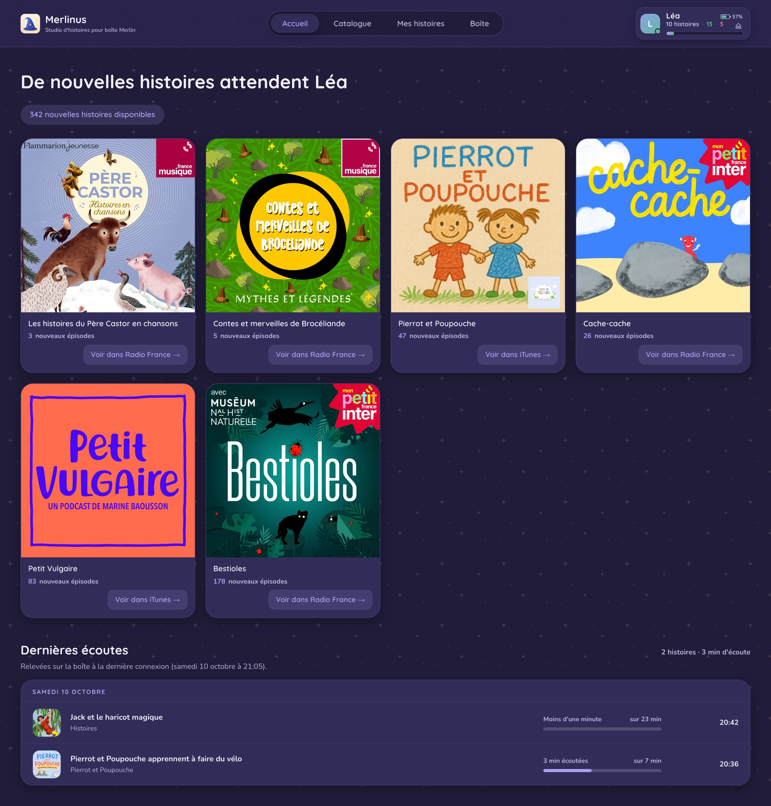
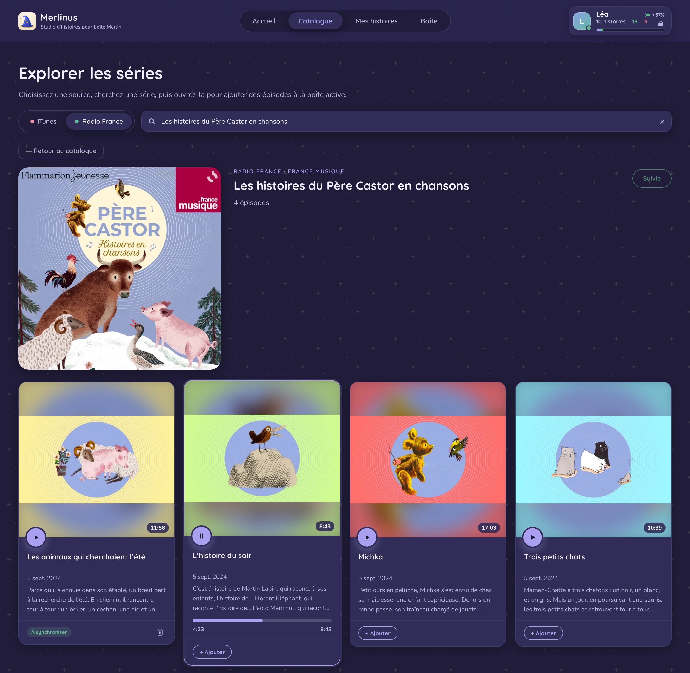
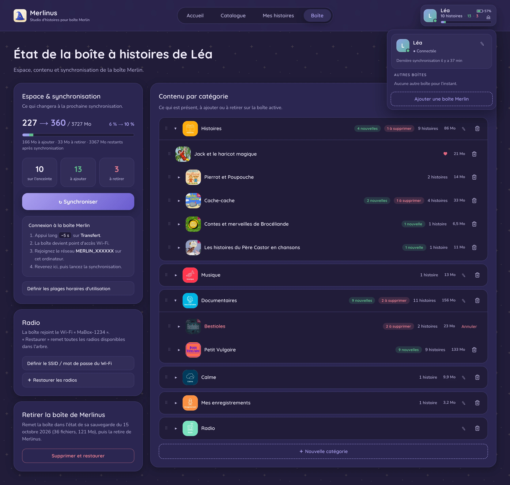

  

# Merlinus

Client de bureau libre pour déposer n'importe quel épisode de podcast, ou un
fichier audio personnel, sur une boîte à histoires Merlin, sans passer par
l'application mobile de l'éditeur.

## Aperçu

<table>
  <tr>
    <td></td>
    <td></td>
    <td></td>
  </tr>
</table>

## Pourquoi

Portabilité des données (RGPD art. 20) et interopérabilité (art. L.122-6-1 IV
du code de la propriété intellectuelle). Le projet ne contourne aucune mesure
technique de protection et ne redistribue aucun contenu sous droits : il permet
au propriétaire de l'appareil d'y déposer ses propres fichiers.

Projet indépendant, sans lien avec Bayard ni avec les éditeurs de la boîte
Merlin. « Merlin » est une marque de son titulaire, employée ici à titre
descriptif pour désigner le matériel avec lequel ce logiciel interopère.

## Sources de contenu

- Recherche de podcasts (API iTunes) et résolution du flux RSS.
- Catalogue Radio France.
- Vos propres fichiers audio (import local).

## Téléchargement

Binaires par système sur la page des
[releases](https://github.com/louis49/merlinus/releases) :

| Système | Fichier |
|---|---|
| macOS (Apple Silicon et Intel) | `Merlinus-macos.dmg` |
| Windows (x86-64) | `merlinus-windows-amd64.exe` |
| Windows (ARM64 : PC Snapdragon...) | `merlinus-windows-arm64.exe` |
| Linux (x86-64) | `merlinus-linux-amd64.tar.gz` |
| Linux (ARM64 : Raspberry Pi 64 bits...) | `merlinus-linux-arm64.tar.gz` |

## Firmware requis

Merlinus fonctionne avec le firmware **2.1.23** de la boîte, ou plus récent.
Les versions antérieures (par exemple 2.1.16) ne sont pas prises en charge :
l'association est alors refusée, et le message indique la version détectée. Il suffit de mettre la boîte à jour avec
l'application mobile de l'éditeur, puis de la reconnecter à Merlinus.

## Brancher la boîte

Merlinus parle à la boîte sur son propre réseau Wi-Fi, sans Internet ni compte :

1. Appui long (environ 5 s) sur le bouton **Transfert** de la boîte : elle
   devient un point d'accès Wi-Fi.
2. Sur l'ordinateur, rejoindre le réseau **MERLIN_...** à la main, avec le
   mot de passe **MERLIN_APP** (voir ci-dessous s'il est refusé). Le système
   signale « Pas d'Internet » ou « connexion limitée » : c'est normal, ce
   réseau ne mène qu'à la boîte.
3. Une fois la synchronisation faite, revenir au Wi-Fi habituel pour parcourir
   le catalogue (il faut quelques secondes avant qu'Internet soit de nouveau
   détecté).

Le mot de passe du réseau **MERLIN_...** est attribué par le serveur de
l'éditeur et inscrit sur la boîte lors des synchronisations faites avec
l'application mobile. **MERLIN_APP** est la valeur que cette application
propose elle-même : dans sa connexion manuelle, un appui long sur l'étape
« Appuyez 5 secondes sur le bouton de transfert » mène au bouton « Copier le
mot de passe ». Si ce mot de passe est refusé, la boîte en a reçu un autre :
l'application ne l'affiche pas, et Merlinus ne peut pas le retrouver non plus.

## Applications non signées : lever la protection de l'OS

Les binaires **ne sont ni signés ni notarisés**. Chaque système bloque donc
l'application au premier lancement, le temps que vous l'autorisiez
explicitement.

### macOS

Ouvrir `Merlinus-macos.dmg`, puis glisser **Merlinus** sur le raccourci
**Applications** dans la fenêtre qui s'affiche. L'application est universelle
(Mac Intel et Apple Silicon).

Téléchargée depuis Internet, elle est mise en quarantaine : au premier
lancement, macOS refuse de l'ouvrir. Deux voies :

- **Interface** : aller dans **Réglages Système > Confidentialité et
  sécurité**, section « Sécurité », puis **« Ouvrir quand même »**, et
  confirmer. (Depuis macOS 15, le clic droit > Ouvrir ne suffit plus pour une
  application non notarisée.)
- **Terminal** : retirer l'attribut de quarantaine de l'application copiée,
  puis la lancer normalement.

      xattr -dr com.apple.quarantine /Applications/Merlinus.app

### Windows

SmartScreen affiche « Windows a protégé votre ordinateur ». Cliquer sur
**« Informations complémentaires »**, puis **« Exécuter quand même »**.

Alternative : clic droit sur le `.exe` > **Propriétés** > cocher
**« Débloquer »** en bas de l'onglet Général > Appliquer. Ou en PowerShell :

    Unblock-File .\merlinus-windows-amd64.exe   # ou merlinus-windows-arm64.exe

L'application s'affiche avec le moteur WebView2 de Microsoft, présent de base
sur Windows 10 et 11. S'il manque (certaines éditions LTSC, Server ou « N »),
Merlinus propose de l'installer au premier lancement : il faut alors Internet.

### Linux

Aucune notarisation. L'archive (`merlinus-linux-amd64.tar.gz` ou
`merlinus-linux-arm64.tar.gz` selon l'architecture) contient le binaire, un
lanceur et une icône ; installation pour l'utilisateur courant :

    tar -xzf merlinus-linux-amd64.tar.gz         # ou merlinus-linux-arm64.tar.gz
    install -Dm755 merlinus/merlinus         ~/.local/bin/merlinus
    install -Dm644 merlinus/merlinus.png     ~/.local/share/icons/hicolor/512x512/apps/merlinus.png
    install -Dm644 merlinus/merlinus.desktop ~/.local/share/applications/merlinus.desktop

Merlinus apparaît alors dans le lanceur d'applications (ou : `~/.local/bin/merlinus`).

Le binaire s'appuie sur les bibliothèques du système pour sa fenêtre (GTK 3,
WebKitGTK 4.1) et pour la lecture audio (GStreamer). Il est construit pour
Ubuntu 22.04 et suivantes, Debian 12 et suivantes. Paquets nécessaires :

    sudo apt install libgtk-3-0 libwebkit2gtk-4.1-0 gstreamer1.0-plugins-good gstreamer1.0-libav

## Compiler depuis les sources

Merlinus est une application [Wails](https://wails.io) v2 : le front (Vite) est
construit puis embarqué dans le binaire Go par `wails build`.

Prérequis :

- [Go](https://go.dev) (version dans [go.mod](go.mod)) et [Node.js](https://nodejs.org) 22 ;
- le CLI Wails : `go install github.com/wailsapp/wails/v2/cmd/wails@v2.16.0` ;
- Linux : `sudo apt install build-essential pkg-config libgtk-3-dev libwebkit2gtk-4.1-dev` ;
- Windows : le runtime WebView2 (présent par défaut sur Windows 10 et 11) ;
- macOS : les outils en ligne de commande Xcode (`xcode-select --install`).

`wails doctor` vérifie l'installation. Puis :

    git clone https://github.com/louis49/merlinus
    cd merlinus
    wails build                                  # macOS, Windows
    wails build -tags webkit2_41                 # Linux (WebKitGTK 4.1)
    wails build -platform darwin/universal       # macOS Intel + Apple Silicon
    scripts/dmg.sh Merlinus-macos.dmg            # macOS : image disque

Le résultat est dans `build/bin/`. La compilation croisée ne fonctionne que
vers Windows (`wails build -platform windows/amd64` ou `windows/arm64`) :
Linux et macOS exigent de compiler sur le système cible (bibliothèques natives
via cgo).

## Soutenir le projet

Le projet est gratuit et libre. Si vous souhaitez le soutenir :

- [PayPal](https://www.paypal.com/donate/?hosted_button_id=B8NGNPFGK69BY)
- [Buy Me a Coffee](https://www.buymeacoffee.com/louis49github)

## Licence

AGPL-3.0-or-later. Voir [LICENSE](LICENSE).
